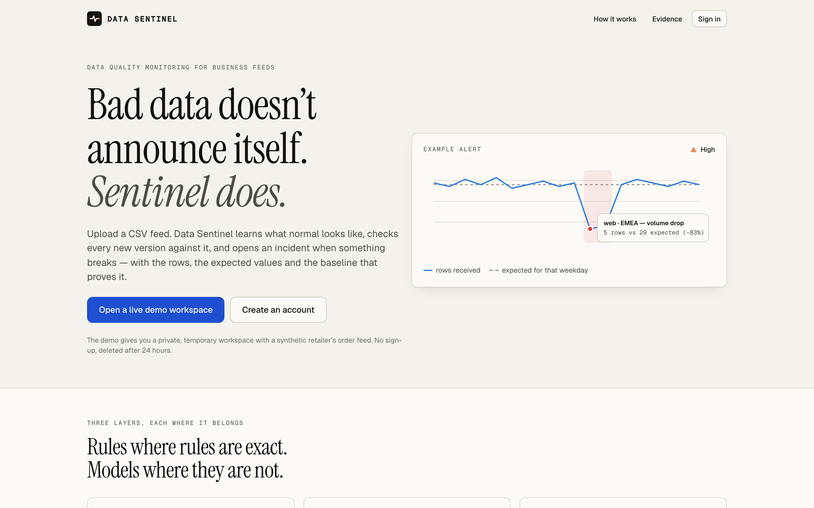
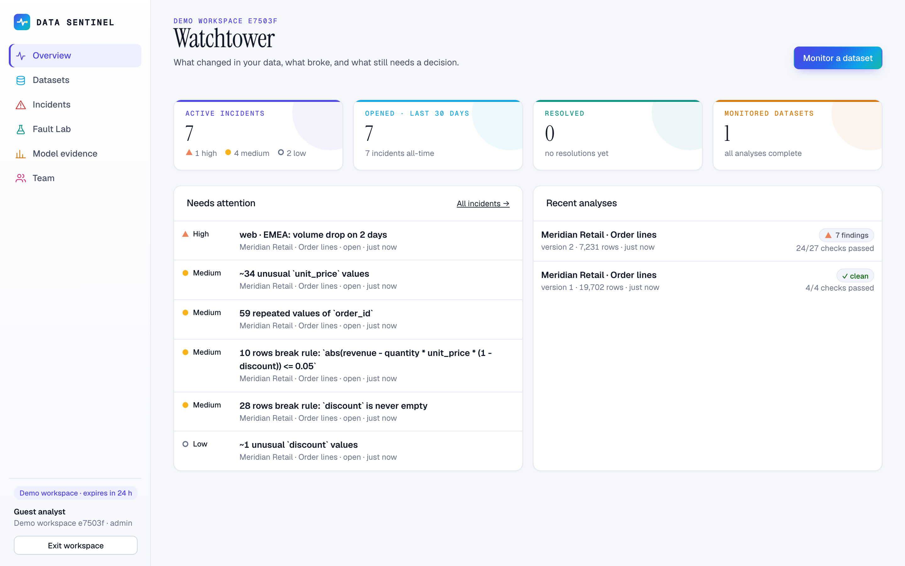
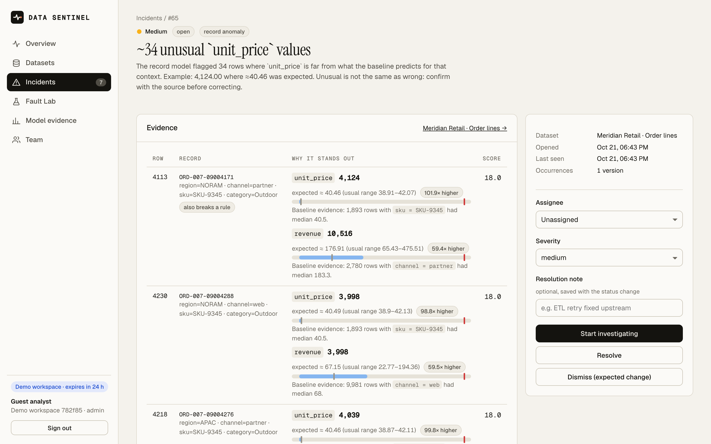
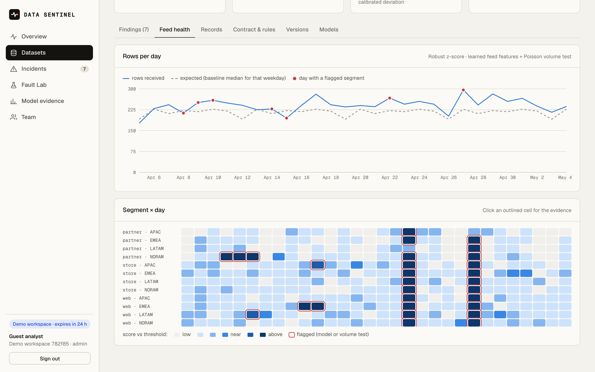
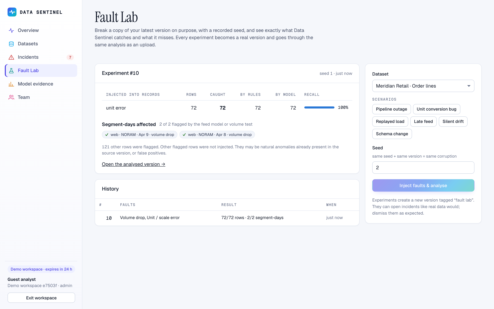

<div align="center">

# DATA SENTINEL

**Find broken, missing, duplicated and unusual business data before it reaches a decision, and see the evidence for every alert.**

[](https://github.com/Ahmedtech7/data-sentinel-ai/actions/workflows/ci.yml)
  

</div>



Data Sentinel watches a data feed that you upload repeatedly as CSV (sales orders, transactions, inventory snapshots). The first upload becomes the **baseline**: the app infers a data contract and trains models of what "normal" looks like. Every later version is checked against it, and problems become **incidents** with severity, owner, status and a timeline. Each incident shows the offending rows, the value the model expected for that context, and the baseline rows that back up that expectation.

It is built to be honest about what it knows. Anomalous is not the same as wrong, so the UI says "unusual", not "corrupt". Every metric below comes from a reproducible evaluation on held-out data, and where it fails (small segments, late arrival in nightly batches) it says so.

## Contents
- [What it does](#what-it-does)
- [How detection works](#how-detection-works)
- [Verified model results](#verified-model-results)
- [Architecture](#architecture)
- [Run it locally](#run-it-locally)
- [Tests](#tests)
- [Deployment](#deployment)
- [Security](#security)
- [Limitations](#limitations)
- [Project layout](#project-layout)

## What it does

| | |
|---|---|
| **Upload any CSV** | Column roles (id, timestamp, numeric, categorical) and the record key are inferred automatically. UTF-8, up to 15 MB / 250k rows by default. |
| **Data contract** | Inferred from the baseline: required columns, allowed values, non-negative ranges, unique keys. Add business formulas such as `abs(revenue - quantity * unit_price * (1 - discount)) <= 0.05`; they are parsed into a safe expression tree, never `eval`'d. |
| **Record model** | Flags rows whose values are far from what their context predicts (this SKU, this channel, this region), with the expected value and range. |
| **Feed model** | Scores every *segment × day* (e.g. `web · EMEA` on Apr 14) for volume vs. the same weekday, completeness, duplication, ingestion delay and mix-adjusted level of each numeric column. |
| **Incidents** | One incident per root cause. Recurrences in later versions are added to the open incident; segment-level symptoms of a record-level cause are folded into it. Status, severity, assignee, comments, timeline. |
| **Fault Lab** | Corrupt a copy of your latest version on purpose (outage, unit bug, replayed load, late feed, silent drift, schema change), with a recorded seed, and get a scorecard of what was caught, by which layer, and what was missed. |
| **Model evidence** | The full offline evaluation in the app: every candidate detector, PR curves, recall per fault type, thresholds, runtime. |
| **Instant workspaces** | One click creates a private workspace (kept for 24 h) with a synthetic retailer and a month containing four realistic incidents. There is no sign-in or sign-up; this is the only way in. |
| **Isolation & roles** | Every workspace is a separate tenant; `viewer` / `analyst` / `admin` roles are enforced server-side. |

<table>
<tr><td></td><td></td></tr>
<tr><td align="center">Overview: what broke and what still needs a decision</td><td align="center">Incident: each row against its learned expectation and baseline peers</td></tr>
<tr><td></td><td></td></tr>
<tr><td align="center">Feed health: rows per day vs. expected, segment × day scores</td><td align="center">Fault Lab: injected faults scored against ground truth</td></tr>
</table>

## How detection works

Three layers, each used where it is the right tool:

1. **Deterministic checks** (`backend/sentinel/engine/checks.py`). Schema changes, unparseable values, contract rules, duplicate keys, missing-value spikes and distribution drift (PSI). When a rule can be exact, no model is involved.
2. **Context model for records** (`engine/modeling.py: Residualizer, RowModel`). For each numeric column a `HistGradientBoostingRegressor` learns the expected value *given the record's categorical context*, and a second one learns the expected spread. Baseline residuals are computed out-of-fold (3-fold) so the model is never scored on rows it was trained on. A record's score is its largest deviation, with each field scaled by the 99.5th percentile of that field's deviations in the baseline. That calibration step cut false positives 5× on zero-inflated columns such as discounts.
3. **Feed model** (`engine/modeling.py: PeriodModel`). Per segment-day: log ratio of rows to the median for the same weekday, empty-cell rate, duplicate-key rate, median ingestion delay, and the clipped mean residual of each numeric column from the context model (a price change is separated from a change in product mix). Scored by a robust z-score per segment, plus a Poisson volume test (≤ 50% of expected rows and p < 10⁻⁵).

The detector and threshold for each level are **not hand-picked**: `python -m sentinel.ml_eval` evaluates every candidate and writes `artifacts/selection.json`, which the app loads.

## Verified model results

Reproduce with `cd backend && python -m sentinel.ml_eval` (~1 min, deterministic; the numbers below are copied from the generated [`report.json`](backend/sentinel/artifacts/report.json)).

**Protocol.** Each stream is an independent synthetic retailer (its own catalog, seed and volumes). Models learn from a 90-day baseline that contains 0.1% unlabelled spikes, since real baselines are never clean. They then score the next 60 days, into which labelled faults are injected. **Validation streams (seeds 11–13)** choose the detector (highest average precision) and its threshold (max F1). **Test streams (seeds 101–105)** are scored once and produce every number below. Legitimate irregularities (bulk partner orders, clearance discounts, guest checkouts) are left unlabelled and count as false positives if flagged. Fault and label definitions: [docs/model-card.md](docs/model-card.md).

### Record level: 72,322 clean rows, 686 faulty rows

| Detector | Family | Val AP | **Test AP** (± sd across 5 streams) | ROC AUC | Precision | Recall | F1 | FPR |
|---|---|---|---|---|---|---|---|---|
| **Context model · calibrated deviation (selected)** | ML | 0.978 | **0.978 ± 0.012** | 0.999 | 0.937 | 0.915 | 0.926 | 0.06% |
| Context model · max deviation | ML | 0.922 | 0.928 ± 0.021 | 0.998 | 0.745 | 0.933 | 0.828 | 0.30% |
| Ensemble (max-z + LOF) · context model | ML | 0.911 | 0.918 ± 0.023 | 0.998 | 0.929 | 0.739 | 0.823 | 0.05% |
| Local Outlier Factor · context model | ML | 0.747 | 0.790 ± 0.026 | 0.985 | 1.000 | 0.650 | 0.788 | 0.00% |
| Isolation Forest · context model | ML | 0.471 | 0.480 ± 0.045 | 0.993 | 0.433 | 0.838 | 0.571 | 1.04% |
| Isolation Forest · group z-scores | ML | 0.258 | 0.289 ± 0.031 | 0.970 | 0.330 | 0.513 | 0.402 | 0.99% |
| z-score · global *(best statistical)* | statistical | 0.580 | 0.625 ± 0.096 | 0.912 | 0.631 | 0.621 | 0.626 | 0.34% |
| IQR fences · global | statistical | 0.515 | 0.551 ± 0.063 | 0.904 | 0.672 | 0.402 | 0.503 | 0.19% |
| Robust z-score · per group | statistical | 0.208 | 0.191 ± 0.324 | 0.965 | 0.237 | 0.695 | 0.354 | 2.12% |

Selected detector, recall by fault: price ×100 **100%**, price ÷100 **99.3%**, one SKU's price ×10 for three days (contextual: a normal price for other SKUs) **100%**, quantity spikes **73.9%** (the misses overlap with legitimate bulk orders).

### Feed level: 3,600 segment-days, 184 faulty

| Detector | Family | Val AP | **Test AP** | Precision | Recall | FPR |
|---|---|---|---|---|---|---|
| **Robust z-score · learned feed features (selected)** | ML features | 0.822 | **0.775 ± 0.057** | 0.856 | 0.745 | 0.67% |
| Ensemble (max-z + LOF) · learned | ML | 0.792 | 0.728 ± 0.042 | 0.857 | 0.750 | 0.67% |
| Local Outlier Factor · learned | ML | 0.753 | 0.717 ± 0.050 | 0.877 | 0.739 | 0.56% |
| Isolation Forest · learned | ML | 0.450 | 0.407 ± 0.053 | 0.414 | 0.429 | 3.28% |
| Robust z-score · weekday-adjusted raw *(best statistical)* | statistical | 0.487 | 0.494 ± 0.073 | 0.534 | 0.554 | 2.61% |
| z-score · per segment | statistical | 0.413 | 0.410 ± 0.078 | 0.686 | 0.380 | 0.94% |

Shipped configuration (selected detector **or** Poisson volume test): precision **0.856**, recall **0.745**, FPR **0.67%**. Recall by fault: duplicate bursts 100%, missing-value bursts 100%, subtle price drift (+25–50% for one segment-day) **92.5%** (the purely statistical baseline catches 5%), late arrival 70%, volume drops 54%.

Volume-drop recall depends on segment size: **22%** when a segment normally has < 10 rows/day, 50% at 10–20, 69% at 20–40, 100% at 40+. Losing half of 6 rows is within normal day-to-day noise.

### Deterministic rules, same test streams

Recall **100%** on sign flips, unparseable values, duplicate loads, missing keys, and a price error that breaks the revenue formula; precision **100%**; **0** rows flagged on 73,008 clean rows.

### What the evidence says
- **Isolation Forest was the starting baseline and lost.** It cannot split on features that are constant in the baseline (duplicate rate is always 0), and irrelevant dimensions dilute isolation depth. It is kept in the report because the comparison is the point.
- **The learning is in the features.** On both levels the gain comes from the gradient-boosted context model. The final scoring rule that won on validation is a simple, explainable max-deviation. On the feed level the same robust z-score over *raw* features scores AP 0.49; over *learned* features it scores 0.78.
- Three negative results are reported, not hidden: the LOF+max-z ensemble did not beat its members, the Poisson test adds no detections on test data once the learned model is in place (it stays because it is the only feed check applied to the baseline itself), and a severity rule based on deviation magnitude was rejected after it mislabelled legitimate bulk orders.

## Architecture

```
            ┌────────────── one container ───────────────┐
 Browser ──▶│ FastAPI ─┬─ /api/*  auth · datasets · incidents · lab
 (React SPA)│          └─ /*      built React app (Vite)  │
            │   │                                        │
            │   ├─ analysis worker (thread, DB-backed run state, resumes on restart)
            │   │     engine: schema → checks → context model → feed model → findings → incidents
            │   │
            └───┼────────────────────────────────────────┘
                ▼
        PostgreSQL (prod) / SQLite (dev): orgs, users, datasets, versions (gzip CSV),
        model artifacts (joblib), runs, findings → incidents, events, lab experiments
```

- **Backend**: FastAPI, SQLAlchemy 2, Alembic, pandas, scikit-learn, SciPy. Python 3.13.
- **Frontend**: React 19, TypeScript, Vite, React Router, Recharts. No UI kit; a small token-based light design system (layered whites, an indigo-to-teal brand gradient, status colours reserved for severity).
- **One deployable unit**: the API serves the built SPA, which removes a CORS surface and needs only one free-tier service.
- **Models are per dataset**, trained on that dataset's baseline and stored versioned (`ENGINE_VERSION`). When the engine changes, older models are retrained from the baseline on the next analysis.

More: [docs/architecture.md](docs/architecture.md).

## Run it locally

Requirements: Python 3.12+, Node 20+.

```bash
python3 -m venv .venv && .venv/bin/pip install -r backend/requirements-dev.txt
(cd frontend && npm ci && npm run build)
cd backend && ../.venv/bin/uvicorn sentinel.main:app --port 8765
```

Open http://localhost:8765 and click **Open your workspace** (the only way in). Migrations run on startup; SQLite is used unless `DATABASE_URL` is set. For frontend development with hot reload, also run `cd frontend && npm run dev` (it proxies `/api` to port 8765).

With Docker (app + Postgres):

```bash
docker compose up --build
```

| Variable | Default | Purpose |
|---|---|---|
| `DATABASE_URL` | SQLite file in `backend/data/` | `postgresql://…` in production |
| `SECRET_KEY` | random per process (dev only) | JWT signing; **required** when `SENTINEL_ENV=production` |
| `MAX_UPLOAD_MB` / `MAX_ROWS` | 15 / 250000 | upload limits |
| `DEMO_ENABLED` / `DEMO_MAX_WORKSPACES` / `DEMO_TTL_HOURS` | true / 40 / 24 | instant-workspace controls |

## Tests

```bash
cd backend && ../.venv/bin/pytest -q          # 24 tests: engine + API (auth, roles, tenant isolation, uploads, lab, demo)
cd e2e && npm ci && npx playwright install chromium && npx playwright test            # browser E2E, local
BASE_URL=https://<deployment> npx playwright test                                      # browser E2E, live
```

CI (`.github/workflows/ci.yml`) runs lint, the test suite on **both SQLite and PostgreSQL**, a type-checked frontend build, and a Docker build that boots the container and creates a workspace through the API.

## Deployment

**Live: https://data-sentinel-ai.vercel.app** (the browser E2E suite passes against it).

Hosting is **Vercel (Hobby) + Neon Postgres (free plan via the Vercel Marketplace)**, $0/month:

- `app.py` is the Vercel entrypoint; `vercel.json` builds the React app and gives the function up to 300 s.
- On Vercel (`VERCEL=1`) the app switches to serverless mode automatically: analyses run inside the request instead of a background thread, uploads are capped at 4 MB (Vercel's request-body limit is 4.5 MB), and rate limits use the forwarded client IP.
- Environment: `DATABASE_URL` (added by the Neon integration), `SECRET_KEY`, `SENTINEL_ENV=production`.
- Trade-offs: a cold start adds a few seconds to the first request; creating a workspace takes about 15 s because the baseline is trained in the request.

```bash
vercel deploy --prod
cd e2e && BASE_URL=https://data-sentinel-ai.vercel.app npx playwright test
```

The same image also runs anywhere Docker does (`Dockerfile`, `docker-compose.yml`, and a `render.yaml` blueprint for Render). See [docs/deployment.md](docs/deployment.md).

## Security

- Passwords: `scrypt` (n=2¹⁴, r=8) with per-user salt, constant-time comparison.
- Sessions: HS256 JWT in an `HttpOnly`, `SameSite=Lax`, `Secure` (production) cookie; `Authorization: Bearer` is also accepted for API clients.
- Authorization: every query is scoped to the caller's organization. Cross-tenant ids return 404 (no existence leak). Roles are checked server-side.
- Uploads: size cap before parsing, binary/encoding rejection, row and column caps, header sanitisation. Stored gzip-compressed in the database, never on a public path. Formula rules use a whitelist AST parser.
- Headers: CSP (`script-src 'self'`), `X-Frame-Options: DENY`, `nosniff`, strict referrer.
- Abuse limits: new workspaces 5/hour/IP, a global cap, and a 24 h TTL.
- The web app has no sign-in or sign-up. The API still has password-based `register`/`login` endpoints (rate-limited 10/min/IP) for programmatic clients and tests.
- Model artifacts are pickled with joblib and only ever loaded from blobs the service wrote itself.
- No secrets in the repository; `SECRET_KEY` is required in production.

## Limitations

- **Synthetic evaluation.** The faults are realistic, but real feeds have their own quirks. Thresholds were tuned on synthetic validation streams and may need per-dataset adjustment (not yet exposed in the UI).
- **Single-process worker.** Analyses run in an in-process thread with DB-persisted state that resumes after a restart. Running more than one instance would need a real queue (RQ/Celery). The rate limiter is also per process.
- **Small segments**: see volume-drop recall by size above.
- **Late arrival** in feeds that already arrive in nightly batches is detected only 70% of the time.
- **Batch, not streaming**: versions are uploaded as CSV. Database/warehouse connectors and scheduled pulls are natural next steps, along with email/Slack alerts and real accounts (with SSO) if it is run for a team.
- **Free hosting**: cold starts of about a minute after 15 minutes idle, and 0.1 CPU makes baseline training several times slower than the ~2 s measured for 20k rows on a laptop (new workspaces reuse a cached model).

## Project layout

```
backend/
  sentinel/engine/   generator · schema · checks · faults · modeling · analyze
  sentinel/api/      auth · datasets · incidents · lab (+ overview, model report)
  sentinel/ml_eval.py           offline evaluation & model selection → artifacts/
  sentinel/{services,jobs,demo,security,models,db,config,main}.py
  migrations/        Alembic
  tests/             pytest
frontend/src/        pages/ · charts.tsx · evidence.tsx · ui.tsx · api.ts · styles.css
e2e/                 Playwright tests + screenshot script
docs/                architecture · model card · deployment · screenshots
```

## License

MIT. All sample data is synthetic and generated by `engine/generator.py`; no real company or person is represented.
